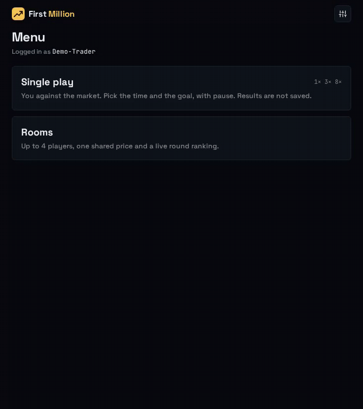

# First Million

Trade against the clock and a living market: pick your starting capital, set your goal, and race to it in real time. Play solo, or challenge up to 3 rivals in a shared room where everyone trades the same price. Think you can reach your goal before the bell? Find out in First Million.



## Stack

TypeScript pnpm monorepo: `shared` (pure simulation engine), `web` (Vue 3, Vite), `worker` (Cloudflare Workers + Durable Objects, Firebase auth).

## Run locally

Requires Node 22 and pnpm.

```sh
pnpm install
cp packages/web/.env.example packages/web/.env.development.local
pnpm dev:auth                    # Firebase Auth emulator, keep running
pnpm --filter @fm/web dev        # http://localhost:5173
```

Rooms also need the Worker: `cp packages/worker/.dev.vars.example packages/worker/.dev.vars` (set `ADMIN_UIDS`), then `pnpm --filter @fm/worker dev`.

## Scripts

| Command | Does |
| --- | --- |
| `pnpm test` | Vitest in all packages |
| `pnpm lint` | ESLint |
| `pnpm typecheck` | TypeScript |
| `pnpm e2e` | Playwright end-to-end checks |

## Docs

- [PRD](docs/PRD.md): rules and scope
- [Architecture](docs/ARCHITECTURE.md): structure and invariants
- [Code quality](docs/CODE_QUALITY.md): code rules
- [E2E and release checklist](e2e/README.md)
